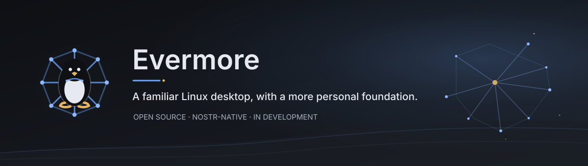

# Evermore

  

**A familiar Linux desktop, with a more personal and connected foundation.**

Evermore is an open-source project exploring how a desktop can put you in
control of your digital identity, information, and tools. It is being built
around the Linux desktop people already know, with Nostr—a free, open
communication protocol—working behind the scenes.

The aim is simple: keep everyday computing familiar while making it easier to
carry your identity and chosen information between services and devices, and
to use an AI assistant that can help with real tasks while leaving important
decisions in your hands.

## Where the project is today

Evermore is an **early prototype**, not a finished operating system. Its
components are being developed and tested in a disposable virtual machine.
There is no supported installer or polished, everyday-ready release yet.

Current experiments include:

- A Sway desktop with a launcher, status panel, and spaces for notifications
  and an AI assistant.
- An assistant that can use selected information and ask for your approval
  before carrying out supported actions.
- Optional on-device AI models, so some assistant work can run on your own
  computer.
- Nostr-based identity and event features, including a first calendar slice
  with public and private events.
- Foundations for bringing settings, notifications, files, and software
  management together under one consistent experience.

These are works in progress. Some features are prototypes, some need more
testing, and others are still on the roadmap. Please do not install Evermore
on a computer you rely on for daily work.

## What is Nostr?

Nostr is an open protocol for sharing signed messages between independent
services. You do not need to understand it to follow the project. Evermore is
designed so ordinary desktop apps can remain ordinary apps; the system can
handle identity and connections for them behind the scenes.

Evermore is not a Nostr account provider or a hosted service. The goal is to
give people more choice over the services and information they use.

## Follow the project

- [Project ideas and roadmap](PROJECT_IDEA.md)
- [Evermore basics implementation roadmap](docs/evermore-basics-roadmap.md)
- [Evermore basics checklist](docs/evermore-basics-checklist.md)
- [Development VM notes](vm/README.md) — for people helping build or test it
- [Browse the source code](https://github.com/imattau/evermore)
- [Share feedback or report a problem](https://github.com/imattau/evermore/issues)

If you are not a developer, feedback about what would make this useful,
confusing, or trustworthy is welcome. If you are a developer, the roadmap and
VM notes explain the current direction and testing setup.

## Privacy and control

User control is a design goal, not a claim that every part is finished or
private by default. Evermore separates signing authority from the assistant
and requires owner approval for supported sensitive actions. Data handling
depends on the feature and the services a person chooses; the project is still
being tested and reviewed.

## License

See the repository's license files for the terms that apply to each component.
